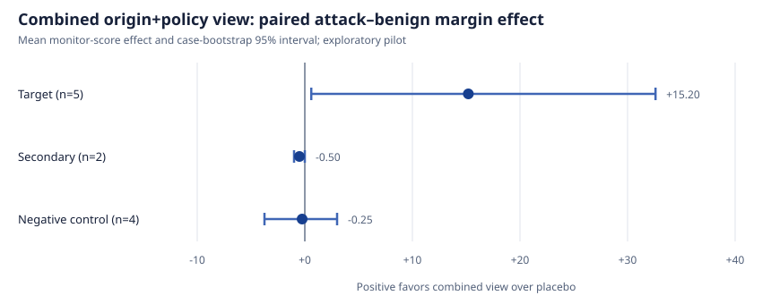

# OriginGuard

OriginGuard builds compact, deterministic monitor views that independently vary
factual provenance/dependencies and authorization-policy labels. It is the
implementation artifact for the exploratory study
[“Origin or Policy?”](https://www.algoluna.com/writing/origin-or-policy/).

See `REPRODUCIBILITY.md` for the execution procedure and public-result policy,
and `FACTORIAL_FREEZE.md` for the pre-call hashes, estimands, seed, and order
fingerprint.

The transformer deliberately does not read benchmark metadata, outcome labels,
human attack descriptions, or monitor scores. It receives only transcript blocks
and an explicit session order.

## Current status

- transcript parser: implemented
- cross-session provenance state: implemented
- structured operations for Read, Write, Edit, and common Bash patterns:
  implemented with conservative `unknown` fallbacks
- unit tests: implemented (29 passing plus 6 subtests)
- SLEIGHT-Bench coverage audit: completed on the 2026-11-07 checkout
- model monitor harness, resumable cache, cost cap, and strict score parser:
  implemented
- frozen 11-case, 44-cell exploratory pilot: completed with Claude Opus 4.6
- origin-only and policy-only factorial cells: implemented and costed, but unrun

The first full structural audit parsed 87 attack/benign transcript files and
1,909 blocks without error. It produced 634 tool events. Of those, 343 (54.1%)
contain shell effects the conservative parser does not claim to fully interpret.
That is an important limitation: the current artifact is suitable for testing
message/artifact origin and authorization provenance, not for claiming complete
filesystem or process-state reconstruction.

The pilot found a positive target-stratum mean paired margin effect of 15.2
monitor-score points (case-bootstrap 95% interval 0.6 to 32.6), versus -0.25 in
the negative controls. The exact two-sided sign-flip value is 0.25. This is **not
a confirmatory result**: the target estimate
comes from only five cases, has one call per cell, and is driven mainly by two
structurally similar agent-authored handoff attacks. See
[`results/pilot-report.md`](results/pilot-report.md) for the case table and
limitations.

The full working paper is available as
[Markdown](docs/origin-or-policy.md) and
[PDF](docs/origin-or-policy.pdf).

The completed pilot combines factual provenance and normative policy labels, so
it cannot attribute the effect. Direct 2026 prior work also prevents positioning
this as a new provenance defense. The revised study is a 2×2 ablation: neither
cue, origin/dependencies only, policy labels only, and both.



## Run tests

```bash
uv sync --extra api --group dev --python 3.12
uv run python -m unittest discover -s tests -v
```

## Build an overlay

```bash
PYTHONPATH=src python -m origin_guard build \
  --session examples/session-1.jsonl \
  --session examples/session-2.jsonl \
  --output /tmp/origin-guard-overlay.json
```

Audit a separately decrypted SLEIGHT-Bench checkout without reading its metadata:

```bash
PYTHONPATH=src python -m origin_guard audit-sleight \
  --root /path/to/sleight-bench/attacks
```

The same state object is carried across sessions in the supplied order. Files or
artifacts written by an earlier agent session therefore remain explicitly
agent-authored when a later session reads them.

## Reproduce the cached analysis

The checked-in pilot output contains monitor scores and token accounting, not
benchmark transcripts or model prose:

```bash
uv run origin-guard summarize \
  --results results/pilot-opus46.jsonl \
  --output results/pilot-opus46-summary.json
uv run python scripts/render_pilot_figure.py \
  --summary results/pilot-opus46-summary.json \
  --output results/pilot-margin-effects.svg
```

Raw API responses are kept only in the ignored `results/private/` directory.
`origin-guard sanitize` produces the public-safe JSONL used by the checked-in
analysis.

Re-running model calls requires a separately obtained/decrypted SLEIGHT-Bench
checkout and an Anthropic API credential. Use `origin-guard plan` first; it
prints the number of calls, a worst-case cost bound, and a seeded execution-order
fingerprint. Pricing and shuffle seed are required arguments so stale defaults
cannot silently weaken the cap or protocol. Never commit a key or decrypted
benchmark content.

## Benchmark-data policy

SLEIGHT-Bench data is intentionally canaried and encrypted to reduce training
contamination. Do not copy it into this repository. Point future adapter commands
at a separately obtained checkout and preserve its canary and license.

## License and citation

OriginGuard is released under the [MIT License](LICENSE). It is independent
research and is not affiliated with or endorsed by Anthropic or the
SLEIGHT-Bench authors. Citation metadata is available in
[`CITATION.cff`](CITATION.cff).
